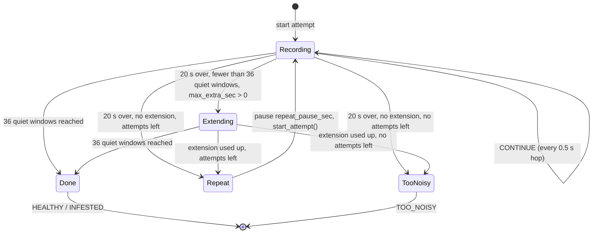

# Noisy test handling: handover for the mobile app

**For:** the mobile app developer. **Reference implementation:** `app/decision/noisy_test.py` (stdlib + NumPy, about 300 lines). **Golden vectors:** `tests/data/noisy_test_vectors.json`. **Design and evidence:** `docs/superpowers/specs/2026-10-28-noisy-test-handling-design.md`.

**Ships switched OFF.** With `enabled: false` the phone must behave exactly as today. It is turned on only with the product owner's approval.

## What it does

Background noise makes the verdict unreliable. Everyday noise (wind, handling, voices) causes **false alarms** on healthy trees, and passing cars can hide an infested tree. So every 0.5 s the phone checks whether that moment is noisy, and **noisy moments do not count toward the verdict**, in either direction.

- Normal test: after 20 s there are 36 quiet windows, and the verdict is the usual EWMA-peak rule over them. Same as today.
- Noisy test: the test keeps recording (up to `max_extra_sec`) until it has 36 quiet windows, then gives the verdict from those 36.
- Still not enough: optionally repeat the test (`max_attempts`), otherwise show **TOO NOISY — please test again**.

Expected effect (simulation on 2026 field recordings, shipped setting): about **1 in 10 fewer false alarms** on healthy trees, the **same** number of infested trees caught, about 1% of tests TOO NOISY, and an average test of **26 s instead of 20** (about half of tests extend a little). Next to a busy road almost every test extends, to about 32 s.

## Flow



In code, `Done` and `TooNoisy` are both the `DONE` action; the result's `verdict` says which.

## What the phone does each 0.5 s hop

1. Take the hop's 22,050 samples (44.1 kHz, mono, float in −1..1, **the raw audio, not the model features**).
2. Compute the window score as today, when there is one. It is `null` for the first 4 hops of every attempt, while the first 2.5 s window fills.
3. Call `feed_hop(samples, score)`, or compute the floor yourself and call `feed_floor(floor_db, score)`. Act on the returned action:
   - `CONTINUE`: keep recording.
   - `EXTENDING` (sent once, at 20 s): keep recording and show "Noise detected — keeping the test running".
   - `REPEAT`: save this attempt, show "Too noisy — repeating test k of n", wait `repeat_pause_sec`, call `start_attempt()`, restart the rolling buffer and the window scoring, and record again.
   - `DONE`: stop recording and show the result's `verdict`.
4. If the user stops early, call `finish()` to get the result as it stands. It is TOO_NOISY if fewer than 36 quiet windows exist.

## The algorithm, precisely

**Hop floor** (`hop_floor_db`). For samples `x`, as float64:
- Return −∞ if `x` is empty or holds any NaN or ∞.
- `limit` = 90th percentile of `|x|`. Use NumPy's default *linear* percentile: sort, position `p/100·(n−1)`, interpolate between the neighbours.
- Clip `x` to ±`limit` (skip the clip if `limit` is 0).
- `rms = sqrt(mean(x²))`. Return −∞ if `rms` ≤ 0, else `20·log10(rms)`.

Clipping removes the short larva clicks, so the floor follows only the steady background.

**Reference.** The `reference_quantile` (0.2) of all *finite* floors so far **in this attempt**, with the same linear interpolation (NumPy `quantile`). Recompute it on every hop.

**Noisy hop.** A hop is noisy if its floor is finite and either:
- `floor − reference > noise_db` (10 dB), when the reference is finite; or
- `floor > abs_noise_db` (null in the shipped config, meaning never).

**Quiet window.** Window `w` (0-based, in the order scores arrived) covers hops `w … w+4` of the attempt. It is quiet if none of those 5 hops is noisy. **The mask is recomputed over the whole attempt on every hop**, because the reference moves. A test that starts during a car is judged against the quiet part that comes after.

**Decision order on each hop**, after storing the floor and the score:
1. If `enabled` is false: `DONE` once `n_hops ≥ normal_hops` (40), else `CONTINUE`.
2. If quiet windows ≥ `min_quiet_windows` (36): `DONE`.
3. If `n_hops < normal_hops`: `CONTINUE`.
4. If `n_hops == normal_hops` and `extra_hops > 0`: `EXTENDING`. Here `extra_hops = round(max_extra_sec / 0.5)`.
5. If `n_hops < normal_hops + extra_hops`: `CONTINUE`.
6. Otherwise `REPEAT` if `attempt < max_attempts`, else `DONE`.

**Verdict.** EWMA peak: `alpha = 2/(span+1)`; the first score starts the EWMA; `peak = max(peak, ewma)` with `peak` starting at 0; INFESTED if `peak > cutoff`.
- `provisional_verdict` = the EWMA peak over **all** windows of the attempt. That is today's answer.
- When disabled, `verdict` = `provisional_verdict`.
- When enabled, `verdict` = the EWMA peak over the **first 36 quiet windows**, in order. If fewer than 36 exist, it is `TOO_NOISY`.

## Configuration (`models/9_1_2/noisy_test.json`)

| Field | Shipped | Meaning |
|---|---|---|
| `enabled` | `false` | Master switch. Off = today's behaviour exactly. |
| `noise_db` | 10.0 | dB above the attempt's reference that makes a hop noisy. |
| `abs_noise_db` | null | Absolute dBFS limit. null = none. (Absolute limits were tested and rejected: they cost infested catches.) |
| `reference_quantile` | 0.2 | Which quantile of the attempt's floors counts as its quiet level. |
| `trim_percentile` | 90.0 | Clip level for the hop floor. |
| `min_quiet_windows` | 36 | Quiet windows needed. Equals the window count the cutoff was fitted on. |
| `hops_per_window` / `normal_hops` | 5 / 40 | 2.5 s window, 20 s normal test. |
| `max_extra_sec` | 40.0 | How much longer a noisy test may run. |
| `max_attempts` | 1 | Attempts before TOO NOISY. |
| `repeat_pause_sec` | 3.0 | Pause before a repeat. |
| `cutoff` / `span` | 0.5697 / 5 | Copied from `decision_threshold.json`. |

JSON has no infinity: `null` in `noise_db` / `abs_noise_db` means "never".

## Golden vectors: how to check your port

`tests/data/noisy_test_vectors.json` holds 17 vectors (`scripts/make_noisy_test_vectors.py` generates them; don't edit by hand):

- **`floor`** (4): `samples` and `expected_db`. Your `hop_floor_db` must match to 1e-9 (null = −∞).
- **`session`** (13): a `config`, then per attempt a list of `hops` as `[floor_db or null, score or null]`, the expected `actions` per hop, and the expected `result`.
  - Feed each hop with `feed_floor`. Your action list must equal `actions`.
  - The closing result must match `result` field by field, with floats to 1e-9. Floor `null` = −∞, score `null` = no window yet.
  - Between attempts call `start_attempt()`.

Together the vectors cover every action and verdict: shipped-off, fitted-on (quiet, burst then extend), warn-only, extension used up, repeat then success, repeat then TOO NOISY, noise at the start, digital silence and the absolute threshold. `tests/decision/test_noisy_test_vectors.py` is the Python replay to copy.

## Open parity point: where the first window starts (decision D3)

The tester scores **36 windows from the first full 2.5 s buffer**: hops 5…40, so the score is null for hops 1–4. Please confirm whether the phone also does that, or scores **40 windows from a zero-filled buffer** (scores from hop 1, the first 4 built on partly-zero audio). The noisy test assumes the tester's way: `score = null` for the first 4 hops of each attempt, then one score per hop. If the phone differs, tell us before porting. The vectors and the cutoff both assume 36.

## What to save (field engineers' data collection)

- **Filename:** as today (`TP_` / `FN_` / `TN_` / `FP_` + timestamp). For a TOO NOISY test, add `_NZ` after the outcome letters, e.g. `FN_NZ_20261028_101530.wav`. The letters come from the **provisional verdict**. Our audio ingest still reads the label from the prefix.
- **Each attempt is its own file.** A repeated attempt that ran out of quiet windows gets `_NZ`.
- **WAV:** the whole attempt (20 s, or longer when extended). The tester used to save only the last 2.5 s; that is fixed.
- **JSON:** keep `predicted_infested`. For TOO NOISY it holds the provisional verdict. Add:
  - `verdict` (`HEALTHY` / `INFESTED` / `TOO_NOISY`) and `duration_sec_actual`;
  - `noisy_test`: the attempt result (`provisional_verdict`, `quiet_peak`, `all_peak`, `n_quiet`, `n_windows`, `n_hops`, `attempt`, `reference_db`, `quiet_mask`, `floors_db`) plus `max_attempts` and the `config` used. The tester writes exactly this, from `AttemptResult.to_dict()`.

## Trying it in the tester

Settings → Acquisition & Output → "Noisy test handling", with the extension, attempts and pause boxes. Noisy windows are shaded orange on the EWMA plot. To replay recordings offline:

```
../.venv/bin/python offline_score.py --corpus <folder> --noisy-test models/9_1_2/noisy_test.json \
    --noisy-out noisy_test.csv [--noisy-max-extra-sec 40] [--noisy-max-attempts 1]
```

That writes one row per attempt and treats a long recording as back-to-back tests.
